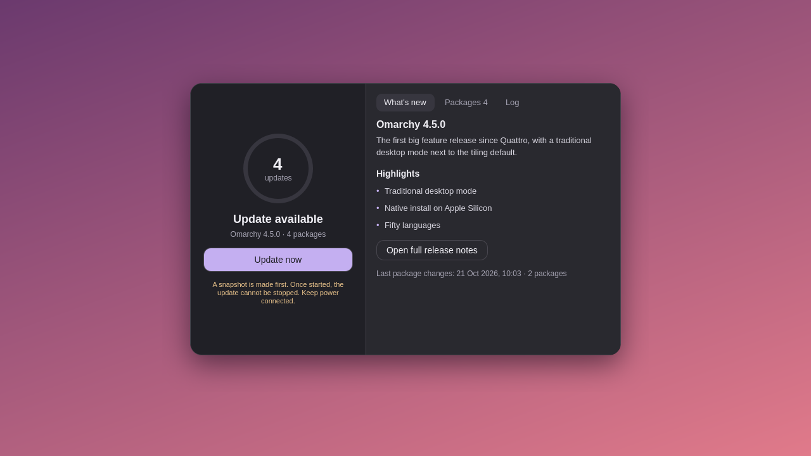

# Velunori Update

> A window for `omarchy update`: what is new, what changes, and how far along it is.



## Features

- Bar icons and icon-only slots follow Omarchy’s active `Style.bar` sizes, including theme/font changes.

- **Studio layout**: compact update status and a connected sequence of stages on the left; release notes, packages and activity on the right. Narrow windows use a stacked status header.
- A fixed footer keeps Update, password entry and restart choices visible. Live progress uses a slim bar instead of a large counter ring.
- **Highlights** shows actual release notes, with a pinned link to the full article. **Packages** lists old/new versions with AUR marked; **Activity** follows live output until you scroll up.
- Mouse wheels and touchpads use the same scrolling speed as Control Center.
- A clear **System is up to date** state with the time of the last check.
- The bar icon appears when updates are pending, spins while updating and turns red after a run that did not finish. It takes the place of the built-in indicator.

## How it updates

- The update is Omarchy's own `omarchy-update -y`, unchanged. This plugin only watches it: the Omarchy command currently running decides the step, and pacman's output gives the package progress.
- When `sudo` asks for the password, the window shows a masked field. The text goes straight to the terminal that asked, and only while that terminal has echo off. It is not stored, logged or passed in arguments. A rejected password is asked for again.
- Yes/no questions from the update, such as rebooting after a kernel update, appear as two buttons.
- The update runs in its own systemd scope, so it survives the shell restart that ends every update; the window reopens afterwards with the result. Escape only hides the window.

Pending updates come from `checkupdates` and `yay -Qua`; release notes from the public GitHub releases of `omacom/omarchy`. Looking installs nothing.

## Requirements

[Velunori Library](https://github.com/Velunori/lib) API 1 (version 1.x), installed in the real sibling `lib/` directory. Works with the stock Omarchy bar; Floating Bars is optional. Developed against **Omarchy 4.0.6-1**.

## Install

Install the shared library first, then run from this repository directory:

```bash
bash scripts/install-local.sh
omarchy-shell velunori.update show
```

Restore the built-in indicator:

```bash
bash ~/dev/Velunori/update/scripts/restore-local.sh
```

## Development

```bash
bash scripts/check.sh
VELUNORI_TEST_LAYOUT=symlink bash scripts/check.sh
```

The backend tests drive a stand-in for `omarchy-update` in a temporary directory through a wrong and a right password, package progress, a reboot question and a failure. **They never run the real update, and neither should you as a test.** The window content is tested offscreen with sample data, including all action states and a short/narrow window. Set `VELUNORI_TEST_UI_ONLY=1` to run only logic and QML checks when local IPC sockets are unavailable; this skips the Python runner tests.

Render one state to an image:

```bash
VELUNORI_PREVIEW_PATH=/tmp/update.png VELUNORI_PREVIEW_STATE=running bash scripts/check.sh
```

States: `available`, `running`, `password`, `confirm`, `failed`, `uptodate`, `checking`. `VELUNORI_PREVIEW_TAB=0|1|2` picks the right-hand tab.

## Limits

- Not yet exercised against a real update: the real `sudo` prompt, the systemd scope, and reopening after the shell restart.
- Questions other than yes/no are not supported; the update would wait (`-y` is meant to prevent them).
- No snapshot restore after a failed update.
- The Update entries in the Omarchy menu still open the terminal update.

## Velunori plugins

Velunori is a set of independent plugins for the [Omarchy](https://omarchy.org) shell. Install only the ones you want; each lives in its own repository and can be removed without touching the others.

| Plugin | What it is |
| --- | --- |
| [bar](https://github.com/Velunori/bar) | The Island and Orbit bars, the appearance settings and the shared design kit |
| [clock](https://github.com/velunori/clock) | Clock in the bar with a month calendar |
| [control-center](https://github.com/velunori/control-center) | Sound, displays, network, capture and reminders in one panel |
| [notifications](https://github.com/velunori/notifications) | Notification cards and a session history |
| [menu](https://github.com/velunori/menu) | The Omarchy command menu as a two-pane panel |
| **update** (this repository) | A window for `omarchy update` with release notes and live progress |
| [weather](https://github.com/velunori/weather) | Weather in the bar with a forecast panel |
| [lockscreen](https://github.com/velunori/lockscreen) | Serene lock screen using Omarchy's session lock and authentication |

## License

MIT, see [LICENSE](LICENSE). 
